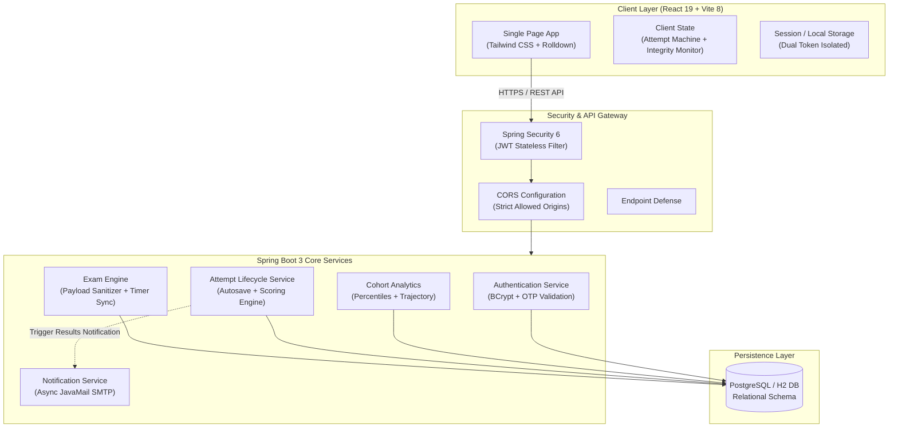
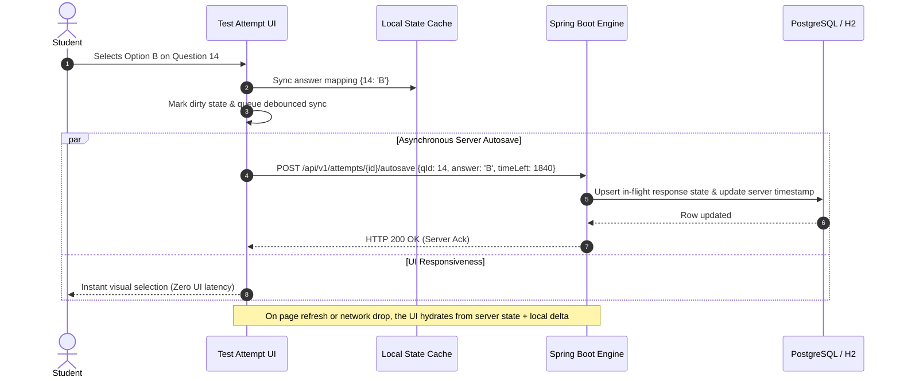
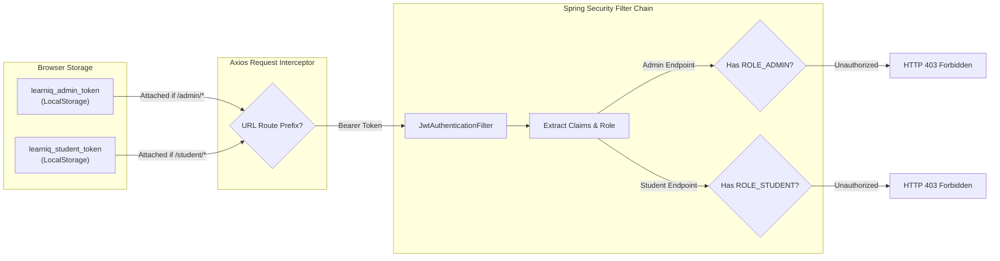

# LearnIQ — Engineering Portfolio Case Study
## Architecture, Session Integrity & Resilient Full-Stack Design

---

### Executive Summary

**LearnIQ** is an academic assessment and learning intelligence platform designed for high-stakes examinations, practice evaluations, and longitudinal performance tracking. Unlike basic quiz applications or dashboard templates, LearnIQ is engineered to address the real-world operational challenges of computer-based testing:

1. **Stateful Examination Lifecycle**: Resilient in-flight attempt tracking with periodic and question-step auto-save, preventing data loss during network disruptions.
2. **Session Integrity & Anti-Abuse Controls**: Server-anchored timer synchronization, window defocus/tab-switch monitoring with auto-submit thresholds, and payload-level answer key masking.
3. **Information Security & Answer Isolation**: Strict API payload sanitization where correct answers and rationales are decoupled from student exam bundles until official post-exam review.
4. **Role Isolation & Session Segregation**: Independent JWT authentication boundaries separating Candidate and Administrator privileges to eliminate privilege escalation risks.
5. **Human-Centric Design System**: Restrained, Apple-inspired ergonomics supporting high-focus testing sessions with dark mode neutrality (`#0E1015`), high-contrast typographic hierarchy, and keyboard-first accessibility.

---

## 1. System Architecture & Component Topology



---

## 2. Core Engineering Challenges & Technical Decisions

### A. The Examination State Machine & Resilient Auto-Save

#### Problem
In standard web assessments, candidate submissions often fail due to sudden network blips, accidental browser refreshes, or device power drops. Losing in-flight responses during an active 60-minute examination destroys user trust.

#### Technical Solution
LearnIQ implements a dual-tier state preservation mechanism combining local state caching with non-blocking server synchronization:



1. **Deterministic Hydration**: When an attempt is mounted, the client fetches `/tests/{id}/attempt`. If a session exists, the server returns the existing attempt ID, populated answers, and verified remaining duration.
2. **Periodic & Event-Driven Autosave**: In addition to debounced option selection, LearnIQ triggers automated background commits on question navigation and visibility changes.
3. **Fail-Safe Final Submission**: Submission executes through a dedicated transactional endpoint `/tests/{id}/submit`. If network failure occurs during submission, the client retries with exponential backoff while retaining the full local answer matrix.

---

### B. Session Integrity, Anti-Abuse Controls & Deterministic Timer Sync

#### Problem
Client-side timers (`setInterval`) drift over time due to CPU throttling, background tab deprioritization, and can be easily paused or edited using browser devtools.

#### Technical Solution
LearnIQ treats the client timer purely as a **display projection**, never as the authority:

1. **Server-Anchored Expiration**:
   - When an attempt starts, the server writes `startTime` and calculates `hardExpiryTime = startTime + durationMinutes`.
   - The remaining time returned to the candidate is calculated dynamically on the server:
     $$\Delta t = \max\left(0, \text{hardExpiryTime} - \text{currentTime}\right)$$
   - The client decrements a local ticker for UI smoothness, but resynchronizes with the server heartbeat periodically.
   - If a student tampers with the client timer, the server rejects answers submitted after `hardExpiryTime` with an `EXAM_EXPIRED` validation error.

2. **Tab Blur & Window Defocus Monitoring**:
   ```javascript
   // Anti-abuse event listeners monitoring window blur & visibility change
   useEffect(() => {
     const handleViolation = (type) => {
       if (malpracticeCooldownRef.current) return;
       malpracticeCooldownRef.current = true;
       setTimeout(() => { malpracticeCooldownRef.current = false; }, 1500);

       setMalpracticeCount(prev => {
         const updated = prev + 1;
         if (updated >= 5) {
           handleAutoSubmit('malpractice');
         } else {
           setShowMalpracticeModal(true);
         }
         return updated;
       });
     };

     document.addEventListener('visibilitychange', () => {
       if (document.hidden) handleViolation('visibility');
     });
     window.addEventListener('blur', () => handleViolation('blur'));
     return () => {
       document.removeEventListener('visibilitychange', handleViolation);
       window.removeEventListener('blur', handleViolation);
     };
   }, [handleAutoSubmit]);
   ```
   *Note: Infractions are tracked per session in `sessionStorage` with a 1.5-second debounce cooldown. Reaching 5 infractions triggers an automated force-submission.*

---

### C. Answer Key Security & Information Isolation

#### Problem
In naive quiz apps, the question payload often includes the correct answer (e.g. `correctAnswer: "B"`) hidden in client memory, allowing students to inspect Network traffic or DOM state to achieve perfect scores.

#### Technical Solution
LearnIQ strictly enforces **Server-Side Answer Masking**:

1. **Attempt DTO Sanitization**:
   - When `/tests/{id}/attempt` or `/tests/{id}/questions` is invoked by a role with `STUDENT` privileges, the Spring Boot Data Transfer Object (DTO) projection strips:
     - `correctAnswer`
     - `explanation` / `rationale`
     - Internal question difficulty weightings
   - The student receives only `{ id, questionText, optionA, optionB, optionC, optionD, category }`.

2. **Authoritative Evaluation**:
   - The candidate posts only their selected option key: `{ questionId: 104, selectedOption: "A" }`.
   - Scoring is performed server-side inside a `@Transactional` boundary against the persisted question entity:
     $$\text{Score} = \frac{\sum_{i=1}^{N} \mathbb{I}(\text{studentAnswer}_i == \text{dbAnswer}_i)}{N} \times 100$$
   - The full answer key, candidate breakdown, and detailed explanations are unlocked only after the attempt status transitions to `SUBMITTED`.

---

### D. Dual-Role Session Isolation & Security Boundaries



#### Key Properties:
- **No Cross-Pollination**: Logging in as an administrator on one tab does not grant student privileges in another, and vice-versa.
- **Stateless Bearer Tokens**: JWTs are signed using HMAC-SHA256 with strict expiration timestamps.
- **Route Guards**: React Router protected routes (`ProtectedRoute.jsx`) verify both token presence and verified role claims prior to rendering protected trees.

---

### E. Render Free-Tier Cold-Start Recovery & Request Idempotency

#### Problem
Free-tier hosting platforms (such as Render) spin down containerized services after 15 minutes of inactivity. When a user first opens the platform, initial backend cold starts typically take 50–90 seconds. Naive SPAs either freeze, display blank screens, or flood the sleeping service with uncoordinated retries that risk duplicating non-idempotent mutations (such as test submissions).

#### Technical Solution
LearnIQ implements a progressive, non-destructive cold-start coordinator:

1. **Non-Blocking Mount**: The application tree (`AuthProvider`, `ThemeProvider`, `BrowserRouter`) mounts immediately without blocking navigation on initial page load.
2. **Progressive Status Feedback**: Rather than a static spinner, an accessible overlay (`role="status"`, `aria-live="polite"`) transitions through phased messaging reflecting real startup stages:
   - *0s–10s*: "Starting LearnIQ…" (Connecting to cloud instance)
   - *10s–30s*: "Checking server…" (Establishing connection)
   - *30s–60s*: "Backend is waking up…" (Database connection pool handshake)
   - *60s–90s*: "Still waking…" (Initializing core engines)
   - *90s+*: "Almost ready…" (Finalizing startup checks)
3. **Non-Idempotent Request Protection**:
   - Assessment submissions (`POST /questions/test/{id}/submit` or `/attempts/{id}/submit`) are **never** automatically replayed upon wake-up.
   - If a submission fails or times out, the error is returned directly to the calling component so existing submission guards can handle it safely without triggering double evaluation.
4. **Transparent Request Queueing**:
   - Safe, idempotent read requests that fail with 500, 502, 503, 504, or network timeout are placed in a promise queue (`failedQueue`).
   - A single, non-overlapping background poll queries `/api/v1/health` every 4 seconds.
   - Upon receiving HTTP 200 `OK`, queued requests are resolved in FIFO order, automatically resuming the user's workflow without page reloads.

---

## 3. Human-Centric Design System & UX Engineering

LearnIQ’s frontend was redesigned away from generic dashboard kits toward an authentic, Apple-grade academic SaaS product:

| Dimension | Generic Dashboard Pattern | LearnIQ Design System Standard |
| :--- | :--- | :--- |
| **Dark Theme** | Jet black `#000000` or saturated navy `#1a1a2e` | Restrained neutral charcoal (`#0E1015` canvas, `#15181E` card surfaces) |
| **Typography** | Inconsistent weights, screaming uppercase headers | Clean sentence-case hierarchy, tabular numbers for timers, tight optical tracking |
| **Brand Identity** | Random gradients and mismatched accent colors | Unified Energy Q emblem with consistent violet (`#7C3AED` / `#6D28D9`) |
| **Leaderboard** | Monochromatic generic table | Three-tier distinctive podium (Radiant Gold, Metallic Platinum, Burnished Copper) |
| **Exam Focus** | Distracting sticky widgets and noisy badges | Minimized header, distraction-free palette, instant question navigation |
| **Code Quality** | Lint warnings, untyped props, heavy bundle | Zero ESLint errors, clean bundle splitting, sub-700ms production builds |

---

## 4. Key Performance Indicators & Engineering Metrics

- **Production Build Speed**: **sub-700ms** (685ms cold build) via Vite 8 and Rolldown chunking.
- **Static Code Analysis**: **0 ESLint errors** across the entire 45-module codebase.
- **Interactive Verification**: 100% verified route coverage across 22 distinct views in both Light and Dark themes via Chrome DevTools Protocol automation.
- **Bundle Optimization**: Asynchronous code-splitting separates heavy dependencies (`html2pdf.js`, PrismJS syntax highlighter) from initial critical paint chunks.

---

## 5. Known Limitations & Environment Requirements

1. **Host Java Runtime Requirement**:
   - The backend service and its 199 unit and integration tests across 18 test suites require JDK 17+ installed on the host operating system. In environments lacking a local Java runtime (such as minimal frontend development containers), the backend can be compiled and run via Docker.
2. **Render Free-Tier Spin-Down**:
   - The deployed backend web service sleeps after 15 minutes of inactivity. The initial request incurs a 50–90 second cold-start latency, coordinated smoothly by the progressive wake-up overlay.
3. **Database Dialect Parity**:
   - Local development uses embedded H2 with `auto-server=true` for rapid developer setup without running PostgreSQL. Production utilizes PostgreSQL on Render. While entity mappings and queries adhere to portable Spring Data JPA conventions, production smoke-testing against a PostgreSQL instance is recommended before major schema migrations.

---

## 6. Architectural Decisions & System Trade-Offs

Key architectural trade-offs and system design rationales:

1. **Disconnection & Data Loss Resilience**:
   - Dual-tier state preservation combining local client storage with debounced, non-blocking server autosave. Deterministic attempt hydration reconstructs in-flight exam sessions upon reload, while transactional backend boundaries guarantee score integrity.
2. **Client-Side Anti-Tampering & Answer Masking**:
   - Complete omission of correct options and rationales in candidate DTO projections prevents DOM/Network inspection cheat vectors. Server-calculated hard expiry times override client clocks, and visibility change listeners log defocus events.
3. **Frontend Performance & Design Foundations**:
   - CSS design token architecture (`#0E1015` dark canvas, high-contrast typography), code-splitting heavy modules (PDF generation, syntax highlighting), zero-lint discipline, and sub-700ms production builds.
4. **Dual-Role Token Segregation**:
   - Candidate (`ROLE_STUDENT`) and Administrator (`ROLE_ADMIN`) credentials and session tokens are strictly isolated in separate storage slots and request interceptors to prevent role clobbering or privilege escalation during concurrent multi-tab usage.
5. **Future Scalability Considerations**:
   - WebSockets for bi-directional live proctor intervention, Redis for distributed timer lease management, and sandboxed Docker containers for multi-language execution in coding examinations.
