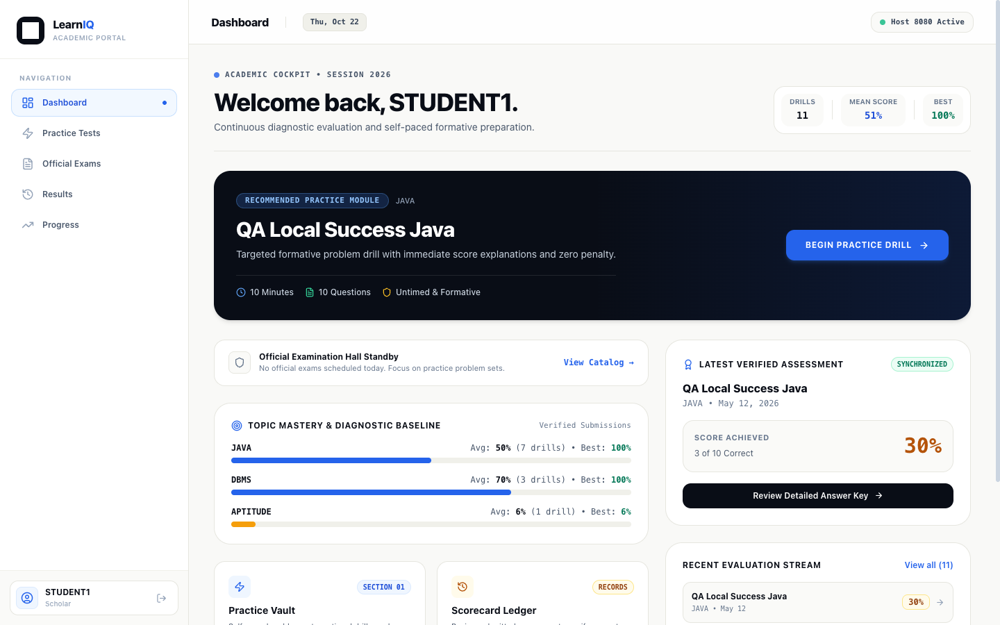
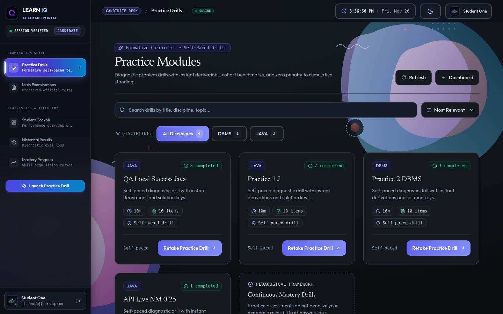

<div align="center">
  

  <h1>LearnIQ</h1>
  <p><b>Online Assessment & Examination Platform</b></p>
  <p>A full-stack web application for conducting timed examinations, practicing topic-based quizzes, and managing assessment workflows.</p>

  <p>
    <a href="https://learniq-frontend-7oyn.onrender.com"></a>
    
    
    
    
    
    
  </p>

  <p>
    <a href="#-live-demo--credentials">Live Demo</a> •
    <a href="#-screenshots">Screenshots</a> •
    <a href="#-features">Features</a> •
    <a href="#-tech-stack">Tech Stack</a> •
    <a href="#-local-setup">Local Setup</a> •
    <a href="#-project-structure">Structure</a>
  </p>
</div>

---

## 🌐 Live Demo & Credentials

The application is deployed on Render and connected to a serverless PostgreSQL database.

* **Frontend:** [https://learniq-frontend-7oyn.onrender.com](https://learniq-frontend-7oyn.onrender.com)
* **Backend API:** `https://learniq-backend-vglf.onrender.com/api/v1`

### Demo Accounts

The database comes pre-seeded with baseline assessment data and two test accounts:

| Role | Email | Password | Access |
|:---|:---|:---|:---|
| **Student** | `student1@learniq.com` | `Student@123` | Dashboard, Practice Drills, Official Tests, Scorecards, Review |
| **Admin** | `admin@learniq.com` | `Admin@123` | Assessment Builder, Question Bank, Test Inventory, Leaderboards |

> ℹ️ **Cold-Start Notice**: Hosted on Render's free tier, the backend service spins down after 15 minutes of inactivity. When accessed cold, an on-screen indicator notifies the user while the server boots up (~60 seconds). Once awake, it remains responsive.

---

## 📸 Screenshots

### Student Experience

<table>
  <tr>
    <td width="50%">
      <b>Candidate Sign-In</b><br/><br/>
      
    </td>
    <td width="50%">
      <b>Student Dashboard</b><br/><br/>
      
    </td>
  </tr>
  <tr>
    <td colspan="2">
      <b>Practice Quizzes (6 Subject Tracks)</b><br/><br/>
      
    </td>
  </tr>
</table>

### Administrator Console

<table>
  <tr>
    <td width="50%">
      <b>Admin Dashboard & Metrics</b><br/><br/>
      
    </td>
    <td width="50%">
      <b>Assessment Builder Studio</b><br/><br/>
      
    </td>
  </tr>
  <tr>
    <td colspan="2">
      <b>Curated Question Bank (300 Questions across 6 Disciplines)</b><br/><br/>
      
    </td>
  </tr>
</table>

---

## ✨ Features

### Student Portal
* **Candidate Authentication:** Registration, login, and password recovery via email OTP.
* **Timed Official Exams:** Scheduled tests with strict duration windows and server-side time validation.
* **Topic Practice Drills:** Unlimited self-paced practice tests across 6 subject categories: Java, Python, ASP.NET, Aptitude, DBMS, and Cloud Computing.
* **In-Exam Auto-Save:** Background answer synchronization saves responses as students navigate questions, preventing data loss on accidental reloads.
* **Basic Focus Tracking:** Detects window blur and tab switching, warns the user, and auto-submits after 5 infractions.
* **Instant Scorecard & Review:** Post-exam breakdown with accuracy percentage, answer key with rationales, and PDF export.

### Faculty / Admin Console
* **Assessment Builder:** 4-step wizard to create tests by selecting discipline, mode (`MAIN` or `PRACTICE`), duration, question quotas, and passing criteria.
* **Question Bank Management:** Central repository of 300+ multiple-choice questions with category filtering, search, pagination, and soft delete.
* **Exam Fleet Control:** Monitor active, scheduled, and archived tests.
* **Leaderboards & Results:** Cohort rankings with podium placements and test completion statistics.
* **Student Directory:** View registered students, verification statuses, and attempt counts.

---

## 🛠️ Tech Stack

| Layer | Technology | Details |
|:---|:---|:---|
| **Frontend** | React 18, Vite 8, Tailwind CSS | Responsive SPA, Lucide icons, html2pdf.js, custom dark/light theme |
| **Backend** | Java 17, Spring Boot 3.5 | Spring Security 6, Spring Data JPA, Hibernate, REST APIs |
| **Security** | JWT (JSON Web Tokens) | Dual-token role isolation (`ROLE_STUDENT` / `ROLE_ADMIN`), BCrypt passwords |
| **Database** | PostgreSQL / H2 | PostgreSQL (Neon serverless) in production; H2 in-memory for local dev |
| **Email** | JavaMailSender | Transactional OTP delivery and scorecard notifications |
| **Hosting** | Render | Static site for frontend; Docker/web service for backend |

---

## 💻 Local Setup

### Prerequisites
* Java 17+ installed
* Node.js 18+ and npm installed
* Git

### 1. Clone the repository
```bash
git clone https://github.com/Nishantsg3/LearnIQ.git
cd LearnIQ
```

### 2. Run the Backend
In development mode (`dev` profile, active by default), the backend uses an embedded H2 in-memory database and auto-seeds 300 baseline questions:

```bash
cd learniq-backend
APP_JWT_SECRET=your_local_dev_jwt_secret_key_32_characters_minimum ./mvnw spring-boot:run
```
* Backend runs at `http://localhost:8080`
* H2 Database console: `http://localhost:8080/h2-console`

### 3. Run the Frontend
In another terminal:

```bash
cd learniq-frontend
npm install
npm run dev
```
* Frontend runs at `http://localhost:5173`
* Log in with either `student1@learniq.com` or `admin@learniq.com` (passwords: `Student@123` / `Admin@123`).

---

## 📁 Project Structure

```
LearnIQ/
├── learniq-backend/               # Spring Boot 3 Java Service
│   ├── src/main/java/             # Controllers, Services, Repositories, Models, Security
│   ├── src/main/resources/        # application.properties, seed JSON files (300 questions)
│   └── src/test/java/             # 201 Unit and Integration Tests (18 test suites)
│
├── learniq-frontend/              # React 18 + Vite Frontend SPA
│   ├── src/components/            # UI components, navigation, layouts, modals
│   ├── src/pages/                 # Student and Admin views, auth flows
│   ├── src/services/              # Axios API client, auth interceptors
│   └── src/assets/                # Logos, branding, and clean screenshot showcases
│
├── PORTFOLIO_CASE_STUDY.md        # Technical architecture case study
└── README.md                      # Project documentation
```

---

## 📄 License

This project is licensed under the [MIT License](LICENSE).

Developed by **Nishant Gawande** ([@Nishantsg3](https://github.com/Nishantsg3)).
