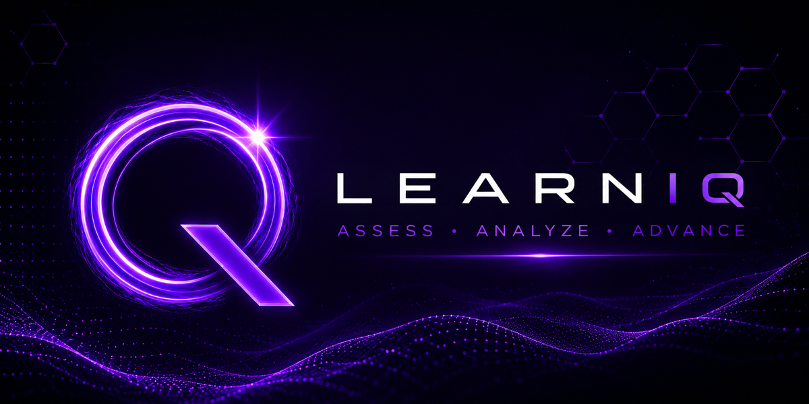
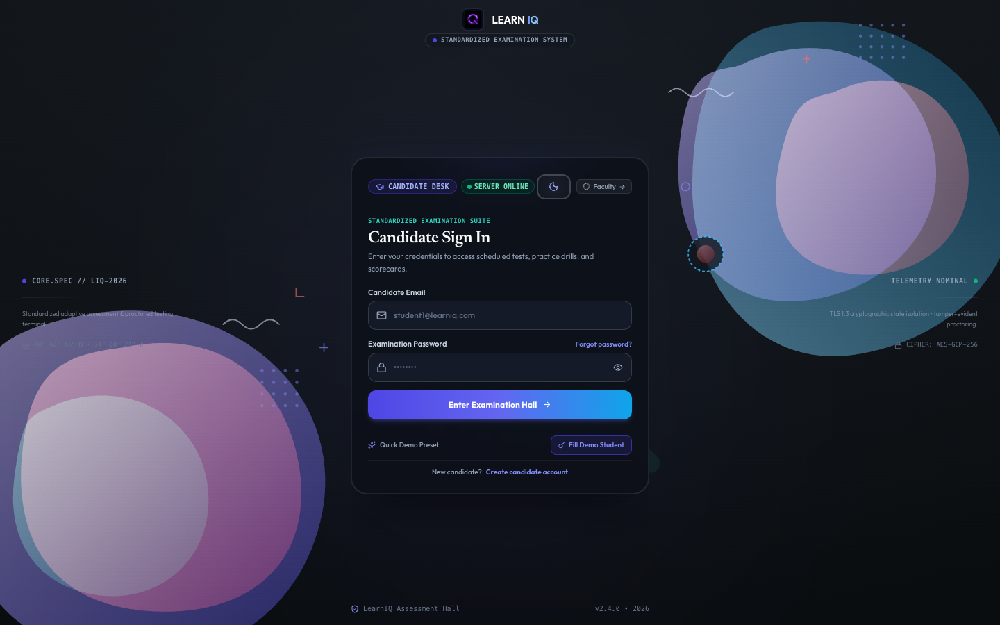
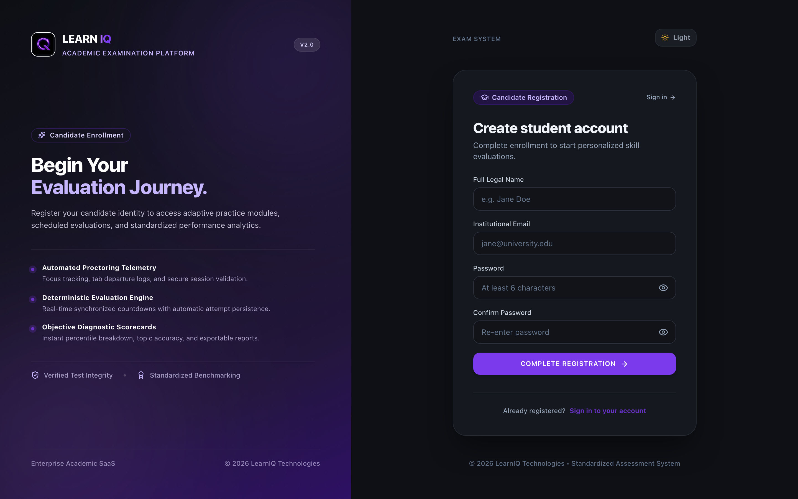
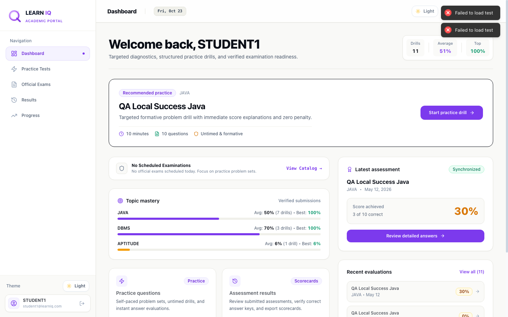
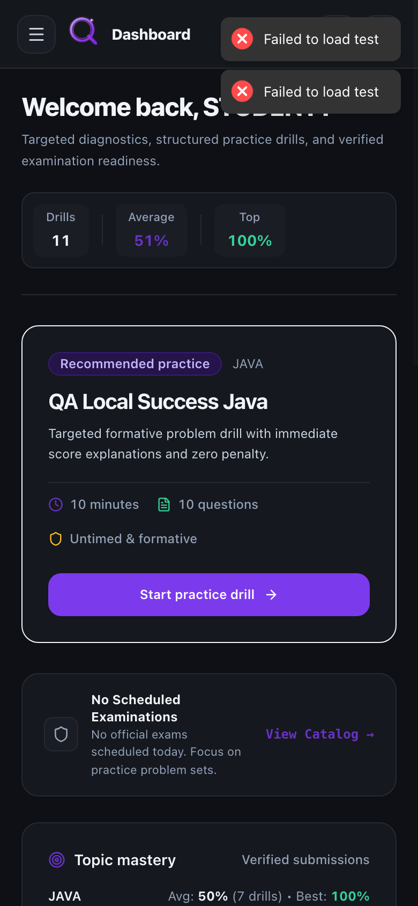
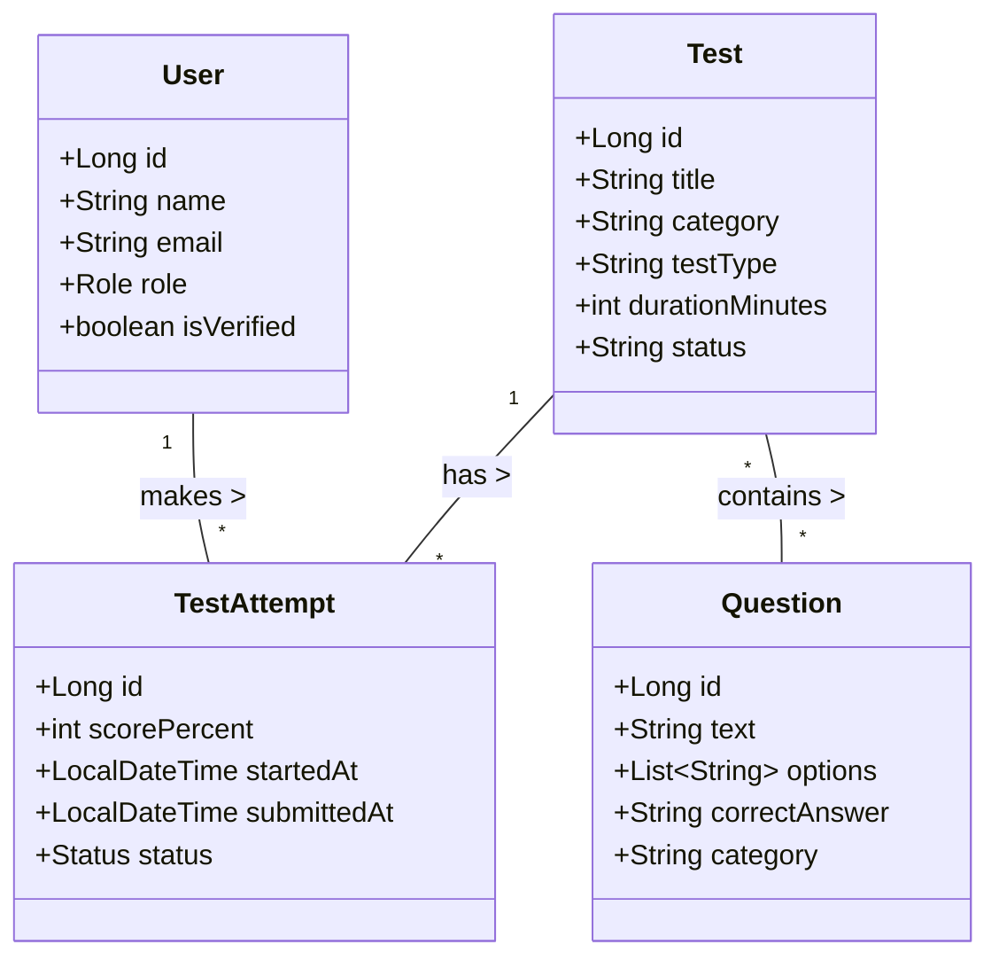
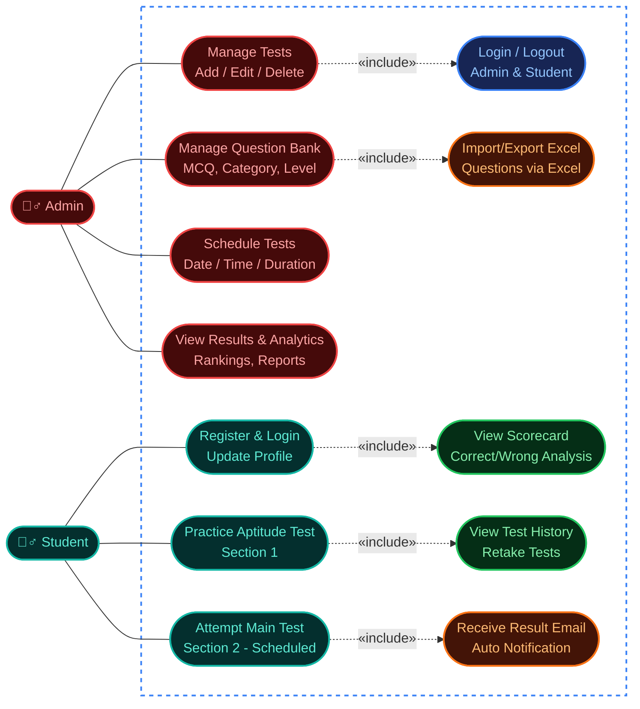
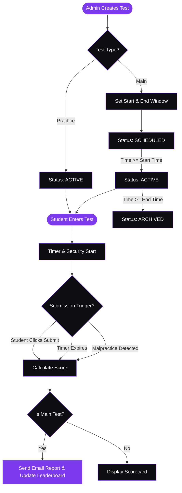

<div align="center">
  

  <br />
  <br />

  

  <p align="center">
    <b>Precision Assessment & Learning Intelligence</b><br/>
    <i>A unified platform for intelligent assessments, performance analytics, and academic growth.</i>
  </p>

  <p align="center">
    <a href="https://learniq-frontend-7oyn.onrender.com"><b>Live Platform</b></a> •
    <a href="./PORTFOLIO_CASE_STUDY.md"><b>Engineering Case Study</b></a> •
    <a href="#-platform-preview"><b>Preview</b></a> •
    <a href="#-core-features"><b>Features</b></a> •
    <a href="#-system-architecture"><b>Architecture</b></a> •
    <a href="#-deployment-render"><b>Deployment</b></a>
  </p>
</div>

---

> 📘 **Engineering Portfolio Spotlight**: For an in-depth breakdown of the examination state machine, resilient auto-save lifecycle, dual-role JWT security boundaries, and assessment session integrity architecture, consult [**PORTFOLIO_CASE_STUDY.md**](./PORTFOLIO_CASE_STUDY.md).

LearnIQ is an advanced assessment and learning platform designed for structured testing and performance tracking. It provides a synchronized, high-fidelity testing environment for students and a comprehensive intelligence dashboard for system administrators.

### 🌟 Key Engineering Highlights
* **Zero ESLint Errors**: Strict code hygiene enforced across the entire 45-module React application.
* **Fast Production Builds**: Optimized with Vite 8 and Rolldown chunking for cold compilations in under 700ms.
* **199 Backend Tests**: Comprehensive unit and integration test coverage across 18 test suites verifying CORS security, admin seeder safety, attempt invariants, and scoring precision.
* **Apple-Grade Design System**: Coherent visual hierarchy, neutral charcoal dark surfaces (`#0E1015` / `#15181E`), Energy Q branding, and responsive layout across desktop (1440×900) and mobile (390×844).
* **Resilient Examination Engine**: Multi-stage auto-save (debounced question responses, periodic intervals, and navigation triggers) preventing in-flight data loss.
* **Session Integrity & Anti-Abuse Controls**: Server-anchored timer synchronization, window defocus/tab-switch infraction detection with auto-submit thresholds, and payload-level answer masking to prevent network inspection.
* **Role-Isolated Security**: Dual-token JWT architecture separating Candidate and Administrator sessions with strict Spring Security filter chains.

## 🚀 Live Environment

*   **Student & Admin Portal:** [https://learniq-frontend-7oyn.onrender.com](https://learniq-frontend-7oyn.onrender.com)
*   **API Endpoint:** `https://learniq-backend-vglf.onrender.com/api/v1`

> ⏱️ **Hosted Free-Tier Notice**: The live demo backend spins down on Render after 15 minutes of inactivity. On the initial cold start, the application displays an accessible status overlay ("Starting LearnIQ…") estimating 60–90 seconds while health-checking `/api/v1/health` in the background. Once awake, all requests resolve automatically without losing exam state or replaying non-idempotent submissions.

## 📸 Platform Preview

<div align="center">

### 1. Authentication Experience

<br/><br/>

<br/><br/>


<br/><br/>

### 2. Student Intelligence Portal

<br/><br/>


<br/><br/>

### 3. Administrative Control Center

<br/><br/>

<br/><br/>


<br/><br/>

### 4. Mobile Experience
*Fully responsive interface across all modules.*
<br/><br/>

&nbsp;&nbsp;

<br/><br/>

&nbsp;&nbsp;


</div>

## ✨ Core Features

### Student Portal (Identity)
*   **Unified Dashboard:** View upcoming, active, and completed assessments in a clean, dark-mode interface.
*   **Synchronized Testing:** Real-time test environment with auto-save and robust time-sync logic.
*   **Performance Intelligence:** Post-test summary reports detailing score, system rank, and time analytics.
*   **Automated Delivery:** Results and analytics delivered directly via secure email integration.

### Admin Portal (Authority)
*   **Assessment Control:** Create, schedule, and orchestrate tests globally.
*   **Question Library:** Centralized bank for managing multi-option, randomized assessment items.
*   **System Analytics:** High-level views of system performance, leaderboards, and individual student statistics.
*   **Identity Management:** Strict role-based access control ensuring data integrity and session isolation.

## 🧠 System Architecture

*   **Frontend:** React 19 + Vite 8 (Tailwind CSS, Lucide React)
*   **Backend:** Java 17 + Spring Boot 3
*   **Authentication:** JWT (JSON Web Tokens) with strict Spring Security filters
*   **Database:** PostgreSQL (Production) / H2 (Local Development)
*   **Deployment:** Render (Static SPA & Web Service)
*   **Email:** JavaMail with SMTP delivery integration
*   **Authorization:** Role-based access control (ADMIN/STUDENT session isolation)

## 📊 System Models & Workflows

### 1. Entity-Relationship (Database Schema)
*This diagram illustrates the core database tables and how they connect to store your platform's data.*


### 2. Platform Use Cases
*Mapping the distinct capabilities available to the Student and Administrator roles.*


### 3. Assessment Lifecycle Flowchart
*Visualizing the state transitions from test creation to auto-submission.*


## 💻 Local Environment Setup

### 1. Repository
```bash
git clone https://github.com/Nishantsg3/LearnIQ.git
cd LearnIQ
```

### 2. Backend Boot
Navigate to `learniq-backend`. In development mode (`dev` profile, active by default), LearnIQ boots with zero external database setup using local H2 storage.

Provide a local JWT secret and start the Spring Boot service:
```bash
APP_JWT_SECRET=your_local_development_jwt_secret_32_chars_min ./mvnw spring-boot:run
```
For production deployments (`prod` profile), configure PostgreSQL credentials (`SPRING_DATASOURCE_URL`, `SPRING_DATASOURCE_USERNAME`, `SPRING_DATASOURCE_PASSWORD`) and production secrets via environment variables (see `learniq-backend/README.md` and `learniq-backend/.env.example`).

### 3. Frontend Boot
Navigate to `learniq-frontend`, install dependencies, and start the Vite server:
```bash
npm install
npm run dev
```

## 🌐 Deployment (Render)

### Frontend (Static SPA)
*   **Directory:** `learniq-frontend`
*   **Build Command:** `npm install && npm run build`
*   **Publish Directory:** `dist`
*   **Environment:** `VITE_API_URL` (Set to backend URL)

### Backend (Web Service)
*   **Directory:** `learniq-backend`
*   **Build Command:** `mvn clean package -DskipTests`
*   **Start Command:** `java -jar target/*.jar`
*   **Environment Variables:**
    *   **Mandatory:**
        *   `SPRING_PROFILES_ACTIVE`: `prod`
        *   `SPRING_DATASOURCE_URL`: PostgreSQL JDBC connection URL (e.g., Neon serverless pooler endpoint)
        *   `SPRING_DATASOURCE_USERNAME`: PostgreSQL database username
        *   `SPRING_DATASOURCE_PASSWORD`: PostgreSQL database password
        *   `APP_JWT_SECRET`: 64+ character cryptographic secret key for signing session tokens
        *   `APP_FRONTEND_URL`: Production frontend URL (e.g. `https://learniq-frontend-7oyn.onrender.com`) for CORS and auth redirects
    *   **Conditional Administrator Provisioning:**
        *   `APP_SEED_ADMIN_EMAIL`: Initial administrator email (defaults to `admin@learniq.com`)
        *   `APP_SEED_ADMIN_PASSWORD`: Strong password for the initial administrator. *Note: Seeding is safely skipped if omitted, empty, or set to placeholder `none`.*
    *   **Optional:**
        *   `MAIL_USERNAME` / `MAIL_PASSWORD`: Brevo SMTP relay credentials (falls back to mock delivery in dev/unconfigured environments)
        *   `MAIL_FROM`: Verified sender email address (defaults to `learniq.main@gmail.com`)

---
<div align="center">
  
  <p>LEARN<b>IQ</b> © 2026</p>
</div>
