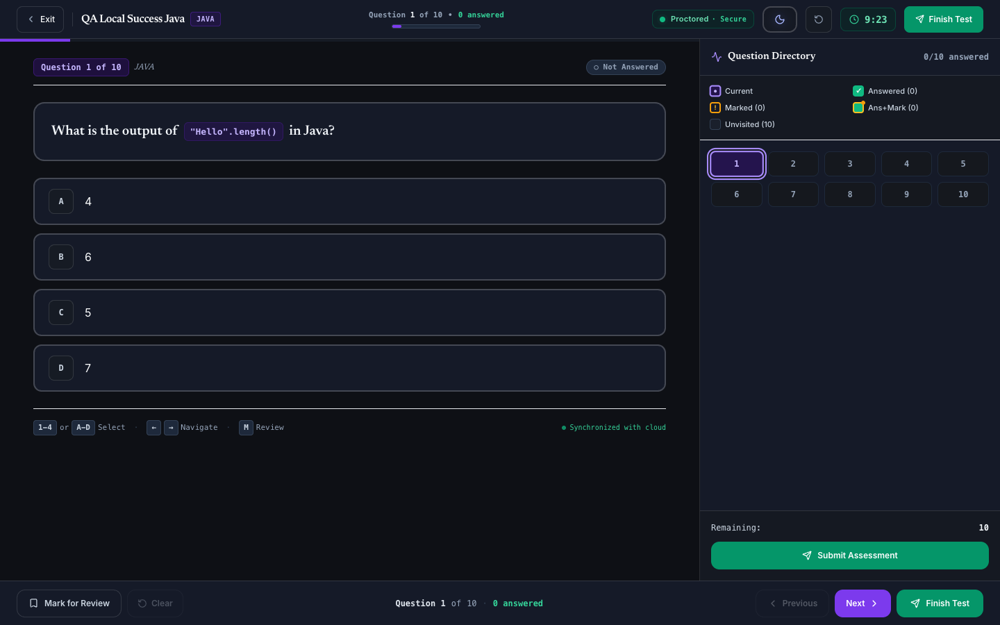
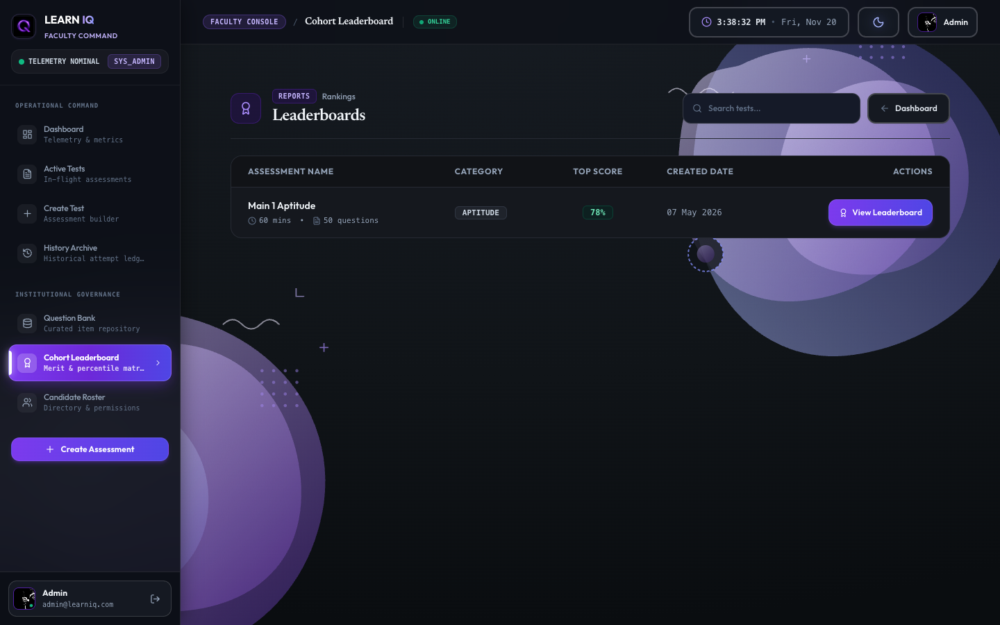
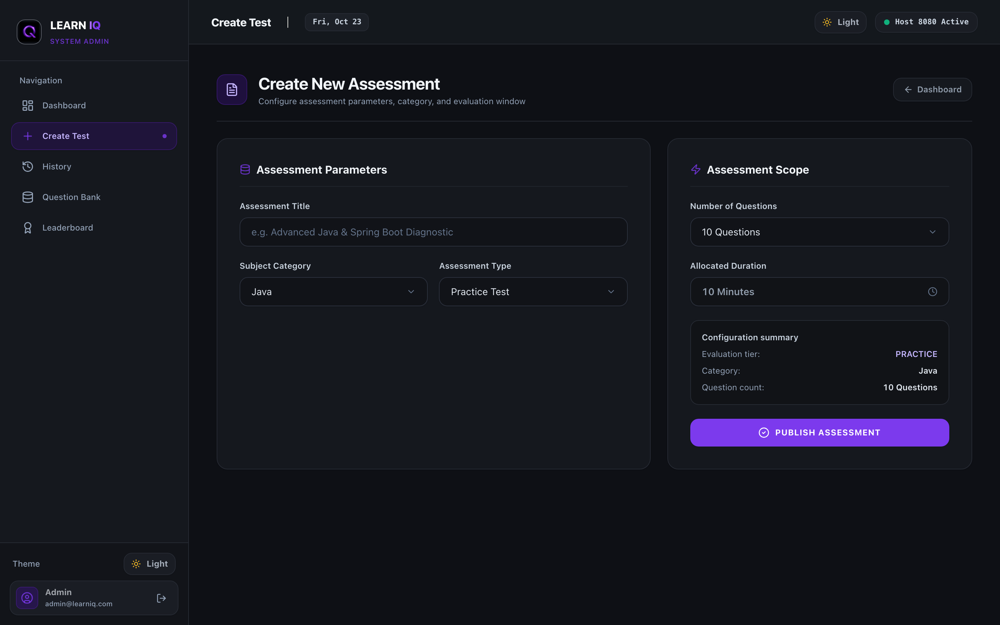
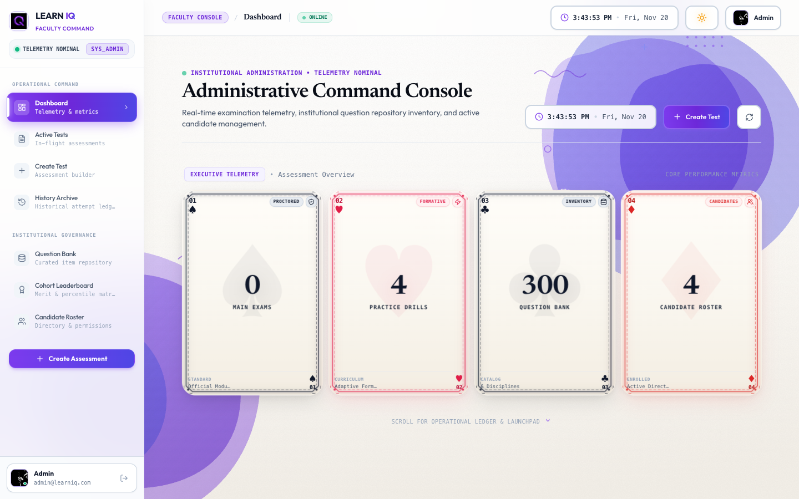
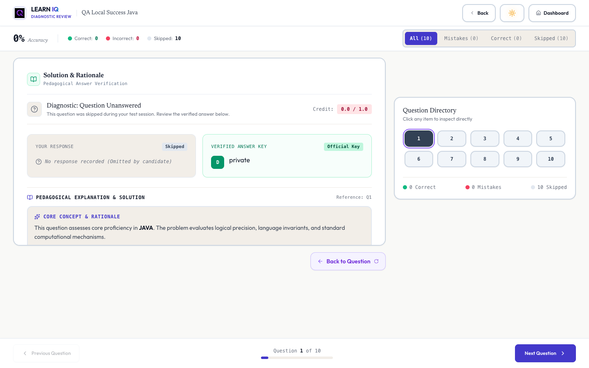
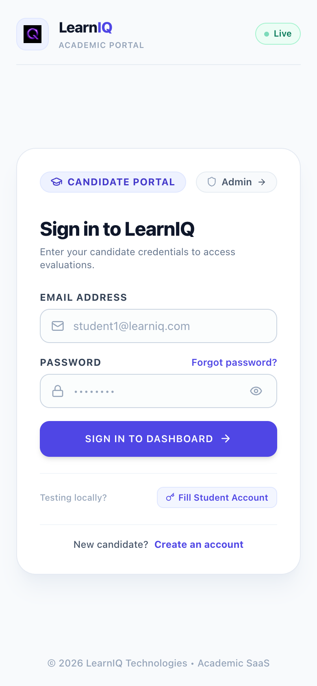
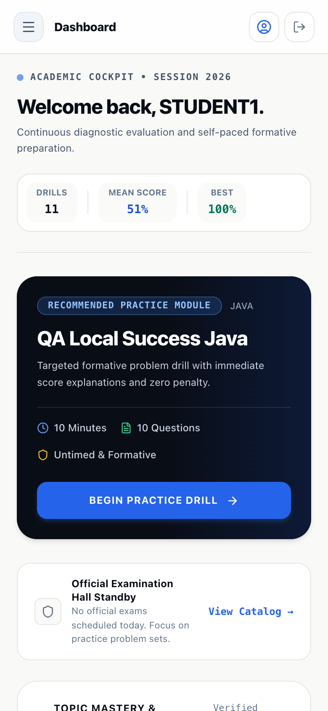
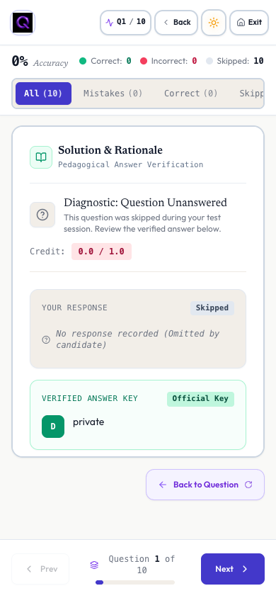

<div align="center">
  

  <h1>LearnIQ</h1>
  <p><b>Modern Online Assessment & Learning Intelligence Platform</b></p>
  <p>A full-stack examination suite featuring synchronized testing, real-time autosave, instant scorecard generation, detailed question rationales, and institutional admin telemetry.</p>

  <p>
    <a href="https://learniq-frontend-7oyn.onrender.com"></a>
    
    
    
    
    
    
  </p>

  <p>
    <a href="#-live-platform">Live Demo</a> •
    <a href="#-visual-showcase">Visual Tour</a> •
    <a href="#-core-features">Features</a> •
    <a href="#-theme--mobile-responsiveness">Themes & Mobile</a> •
    <a href="#-tech-stack">Tech Stack</a> •
    <a href="#-quick-start">Local Setup</a>
  </p>
</div>

---

## 🌐 Live Platform

* **Web Application:** [https://learniq-frontend-7oyn.onrender.com](https://learniq-frontend-7oyn.onrender.com)
* **REST API:** `https://learniq-backend-vglf.onrender.com/api/v1`

> 💡 **Instant Evaluation**: Create a candidate account in seconds via the **[Register Page](https://learniq-frontend-7oyn.onrender.com/register)** or use the one-click **Quick Demo Preset** buttons on the sign-in screen to explore candidate and faculty consoles.

> ⏱️ **Free-Tier Notice**: Hosted on Render's managed tier, the backend spins down after 15 minutes of inactivity. When accessed cold, an on-screen status banner guides the user while the server initializes (~60s), ensuring seamless handoff without lost inputs.

---

## 📸 Visual Showcase

### 1. Live Examination Environment
A focused, distraction-free testing environment equipped with a server-synced countdown timer, syntax-highlighted code questions, custom radio inputs, keyboard shortcuts (`A-D`, `← →`, `M`), and a real-time question navigation palette.

<div align="center">
  
</div>

<br/>

### 2. Question-by-Question Solution Audit & Review
Post-submission diagnostic review breaking down each item with verified answer keys, core concepts, step-by-step rationales, candidate response comparisons, and one-click mistake filtering.

<div align="center">
  
</div>

<br/>

### 3. Faculty Command Center & Cohort Leaderboard
Institutional governance hub featuring live telemetry, active test fleet metrics, and cohort standings with Gold, Silver, and Bronze podium rankings.

<table>
  <tr>
    <td width="50%">
      <b>Admin Telemetry Dashboard</b><br/><br/>
      
    </td>
    <td width="50%">
      <b>Cohort Leaderboard & Podium Medals</b><br/><br/>
      
    </td>
  </tr>
  <tr>
    <td width="50%">
      <b>Curated Question Bank (300+ Items across 6 Tracks)</b><br/><br/>
      
    </td>
    <td width="50%">
      <b>4-Step Assessment Builder Studio</b><br/><br/>
      
    </td>
  </tr>
</table>

---

## 🎨 Theme & Mobile Responsiveness

### Dark & Light Mode Fidelity
Seamless switching between deep charcoal dark surfaces (`#0E1015` / `#15181E`) and crisp warm ivory light surfaces with high-contrast slate typography.

<table>
  <tr>
    <td width="50%" align="center">
      <b>Dark Theme (High-Focus)</b><br/><br/>
      
    </td>
    <td width="50%" align="center">
      <b>Light Theme (Editorial Warm Ivory)</b><br/><br/>
      
    </td>
  </tr>
  <tr>
    <td width="50%" align="center">
      <b>Dark Mode Solution Review</b><br/><br/>
      
    </td>
    <td width="50%" align="center">
      <b>Light Mode Solution Review</b><br/><br/>
      
    </td>
  </tr>
</table>

<br/>

### Mobile Experience (390×844)
Touch-optimized interfaces with collapsible drawers, full-width inputs, and responsive card layouts across all viewports.

<div align="center">
  <table>
    <tr>
      <td align="center" width="33%">
        <b>Candidate Desk</b><br/><br/>
        
      </td>
      <td align="center" width="33%">
        <b>Student Cockpit</b><br/><br/>
        
      </td>
      <td align="center" width="33%">
        <b>Mobile Solution Audit</b><br/><br/>
        
      </td>
    </tr>
  </table>
</div>

---

## ✨ Core Features

### 🎓 Candidate (Student) Portal
* **Synchronized Exam Taking**: Stateful assessment player with server-anchored countdown timers and answer key masking to prevent client-side inspection.
* **In-Flight Auto-Save**: Non-blocking background synchronization (`/api/v1/tests/{id}/autosave`) caches answers on every question selection, safeguarding against network dropouts.
* **Practice Drills**: Self-paced curricular quizzes across 6 tracks: Java, Python, ASP.NET, Aptitude, DBMS, and Cloud Computing.
* **Session Integrity Safeguards**: Detects window blur and tab switching, warns candidates, and triggers auto-submission after 5 infractions.
* **Instant Scorecard & PDF Export**: Automated grading upon submission, performance percentage, and client-compiled PDF scorecard downloads.
* **Question-by-Question Review**: In-depth explanations, correct answer rationales, and mistake filtering.

### 🛡️ Faculty (Admin) Console
* **Assessment Authoring Studio**: 4-step wizard to build tests: discipline selection, protocol mode (`MAIN` or `PRACTICE`), duration, question quotas, and passing criteria.
* **Central Question Bank**: 300+ curricular items across 6 tracks with instant search, category filters, and pagination.
* **Cohort Leaderboards**: Live merit rankings with Gold, Silver, and Bronze podium medals.
* **System Telemetry**: Real-time overview of active candidates, total assessments, and question inventories.
* **Candidate Directory**: User management with verification badges and attempt histories.

---

## 🛠️ Tech Stack

| Domain | Technology | Highlights |
|:---|:---|:---|
| **Frontend** | React 18, Vite 8, Tailwind CSS | Sub-second compilation, Lucide icons, html2pdf.js, custom themes |
| **Backend** | Java 17, Spring Boot 3.5 | Spring Security 6, Spring Data JPA, Hibernate, REST APIs |
| **Authentication** | JWT (Stateless Bearer) | Dual-token role isolation (`ROLE_STUDENT` / `ROLE_ADMIN`), BCrypt hashing |
| **Database** | PostgreSQL 15+ / H2 | PostgreSQL (Neon serverless) in production; zero-config H2 for local development |
| **Notifications** | JavaMailSender | Transactional OTP delivery and asynchronous scorecard notifications |
| **Deployment** | Render.com | Automated static SPA hosting and containerized backend web service |

---

## ⚡ Quick Start

### Prerequisites
* Java 17+
* Node.js 18+ and npm
* Git

### 1. Clone the repository
```bash
git clone https://github.com/Nishantsg3/LearnIQ.git
cd LearnIQ
```

### 2. Start Backend Service
The backend boots in `dev` mode with zero database configuration using embedded H2 in-memory storage and pre-seeds 300 curricular questions:

```bash
cd learniq-backend
APP_JWT_SECRET=your_local_development_jwt_secret_key_32_chars_min ./mvnw spring-boot:run
```
* Service runs at: `http://localhost:8080`
* H2 Database Console: `http://localhost:8080/h2-console`

### 3. Start Frontend Application
In another terminal:

```bash
cd learniq-frontend
npm install
npm run dev
```
* Open [http://localhost:5173](http://localhost:5173) in your browser.
* Use the one-click **Quick Demo Preset** buttons on the login screen to sign in instantly.

---

## 🧪 Testing & Code Quality

LearnIQ enforces strict verification suites across both frontend and backend:

* **Backend Suite:** **201 unit and integration tests** passing across 18 test suites (`./mvnw test`).
* **Frontend Hygiene:** **0 ESLint errors or warnings** (`npm run lint`).
* **Build Verification:** Production bundle compiles cleanly via Vite in under 750ms (`npm run build`).

---

## 📄 License & Attribution

This project is licensed under the [MIT License](LICENSE).

Crafted by **Nishant Gawande** ([@Nishantsg3](https://github.com/Nishantsg3)).
