<div align="center">
  

  <br />
  <br />

  

  <p align="center">
    <b>Precision Assessment & Learning Intelligence Platform</b><br/>
    <i>A unified, full-stack examination suite engineered for stateful session integrity, anti-abuse resilience, and cohort performance analytics.</i>
  </p>

  <p align="center">
    <a href="https://learniq-frontend-7oyn.onrender.com"></a>
    <a href="./PORTFOLIO_CASE_STUDY.md"></a>
    <a href="#-test-metrics--quality-gates"></a>
    <a href="#-test-metrics--quality-gates"></a>
    <a href="#-system-architecture--tech-stack"></a>
    <a href="#-system-architecture--tech-stack"></a>
  </p>

  <p align="center">
    <a href="#-live-environment--demo-access"><b>Live Access</b></a> •
    <a href="#-platform-tour--visual-showcase"><b>Screenshots</b></a> •
    <a href="#-core-capabilities"><b>Features</b></a> •
    <a href="#-system-architecture--tech-stack"><b>Architecture</b></a> •
    <a href="#-data-models--lifecycle-workflows"><b>Data Models</b></a> •
    <a href="#-cold-start-resilience--session-integrity"><b>Resilience</b></a> •
    <a href="#-restful-api-reference"><b>API Reference</b></a> •
    <a href="#-local-environment-setup"><b>Setup Guide</b></a> •
    <a href="#-production-deployment-render"><b>Deployment</b></a>
  </p>
</div>

---

> 📘 **Engineering Portfolio Spotlight**: For a technical breakdown of the assessment state machine, debounced auto-save lifecycle, dual-role JWT security boundaries, and answer key masking controls, see [**PORTFOLIO_CASE_STUDY.md**](./PORTFOLIO_CASE_STUDY.md). For the visual design audit and WCAG contrast verifications, see [**REDESIGN_VISUAL_AUDIT.md**](./REDESIGN_VISUAL_AUDIT.md).

---

## 💡 Executive Overview

**LearnIQ** is an enterprise-grade academic assessment and learning intelligence platform designed for standardized examination delivery, timed practice evaluations, and longitudinal performance tracking. Unlike basic quiz applications or template dashboards, LearnIQ is architected to solve real-world operational challenges in computerized assessment:

* **Stateful Examination Lifecycle**: Multi-tier response preservation combining client-side answer caching with non-blocking, debounced server-side auto-save (`/api/v1/tests/{id}/autosave`), preventing answer loss during network disruptions.
* **Deterministic Server Timer Synchronization**: Client timers serve exclusively as visual projections. The Spring Boot backend computes dynamic remaining duration against immutable database timestamps ($\Delta t = \max(0, \text{hardExpiry} - \text{now})$) and rejects expired submissions.
* **Session Integrity & Anti-Abuse Controls**: Real-time browser tab-switch and window defocus monitoring with a 1.5s debounce cooldown, threshold infractions tracking, and automated force-submission safeguards.
* **Payload-Level Answer Isolation**: Student assessment bundles strictly mask `correctAnswer`, rationales, and category metrics until an attempt is officially submitted and locked.
* **Dual-Token Role Isolation**: Independent JWT storage channels (`learniq_student_token` and `learniq_admin_token`) with dedicated Spring Security filter chains prevent privilege escalation across concurrent sessions.
* **Cold-Start Resilience for Cloud Run/Render**: Zero-friction recovery with automated server health polling (`/api/v1/health`), live status overlays ("Examination servers are waking up..."), and automatic credential handoff on server wake.
* **Self-Healing Curricular Question Bank**: Automated baseline inventory reconciliation restores missing curricular seed questions across 6 subject tracks (Java, Python, ASP.NET, Aptitude, DBMS, Cloud).

---

## 🚀 Live Environment & Demo Access

| Service | Endpoint | Status |
|:---|:---|:---|
| **Web Portal (SPA)** | [https://learniq-frontend-7oyn.onrender.com](https://learniq-frontend-7oyn.onrender.com) | `Production Live` |
| **REST API Gateway** | `https://learniq-backend-vglf.onrender.com/api/v1` | `Production Live` |
| **Server Health Probe** | `https://learniq-backend-vglf.onrender.com/api/v1/health` | `JSON Status` |

### 🔑 Verified Demo Credentials

The platform is pre-seeded with baseline assessment data and verified credentials for evaluation:

| Role | Email Address | Password | Permissions & Scope |
|:---|:---|:---|:---|
| **Candidate (Student)** | `student1@learniq.com` | `Student@123` | Dashboard, Practice Drills, Scheduled Official Tests, Scorecards, Question Review, Performance Analytics |
| **Faculty (Administrator)** | `admin@learniq.com` | `Admin@123` | Telemetry Dashboard, Assessment Creator Studio, Question Bank (300+ items), Test Fleet Management, Analytics, Leaderboards, Candidate Directory |

> ⏱️ **Hosted Free-Tier Cold Start Notice**: The production backend is hosted on Render's managed tier, which spins down after 15 minutes of inactivity. On the initial cold visit, the application displays a real-time status banner ("Starting LearnIQ Examination Servers...") estimating 60–90 seconds while polling the backend health probe in the background. Once awake, all pending requests resolve smoothly without data loss.

---

## 📸 Platform Tour & Visual Showcase

All screenshots were captured live at 2880×1800 Retina resolution from active authenticated sessions across the redesigned dark charcoal surface theme (`#0E1015` / `#15181E`).

### 1. Authentication & Cloud Server Wake Lifecycle

<div align="center">
  <h4>Candidate Sign-In</h4>
  
  <p><i>Candidate Sign-In featuring Energy Q branding, role switcher, and live server connection status.</i></p>
  <br/>

  <h4>Cold-Start Resilience & Server Waking Overlay</h4>
  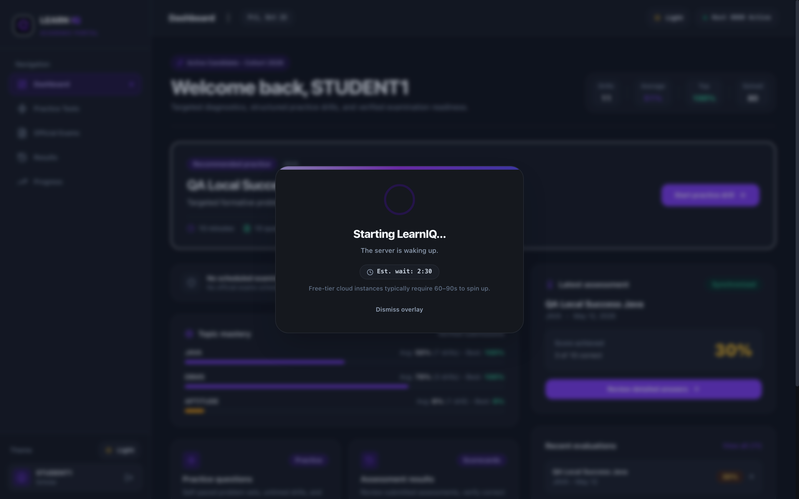
  <p><i>Real-time status overlay and background health polling during Render free-tier cold boot.</i></p>
  <br/>

  <h4>Candidate Account Registration</h4>
  
  <p><i>Full registration flow with client validation, password strength indicators, and session initialization.</i></p>
  <br/>

  <h4>Secure Password Recovery & OTP Verification</h4>
  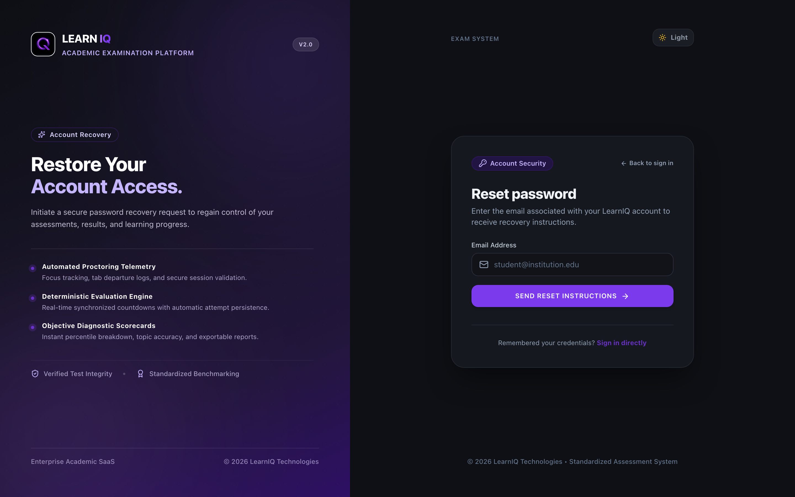
  <p><i>Two-step verification flow with time-limited OTP delivery via JavaMail / Brevo SMTP relay.</i></p>
</div>

---

### 2. Student Learning Cockpit & Examination Engine

<div align="center">
  <h4>Student Intelligence Dashboard</h4>
  
  <p><i>Personalized candidate hub showing active official exams, practice drills, and quick metrics.</i></p>
  <br/>

  <h4>Timed Practice Drills</h4>
  
  <p><i>On-demand curricular practice modules across Java, Python, ASP.NET, Aptitude, DBMS, and Cloud.</i></p>
  <br/>

  <h4>Scheduled Official Examinations</h4>
  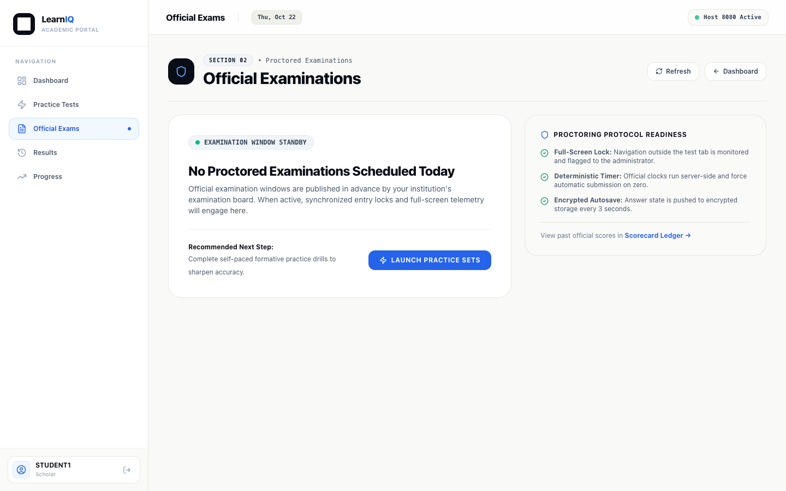
  <p><i>High-stakes scheduled assessments with strict start/end time windows and duration enforcement.</i></p>
  <br/>

  <h4>In-Flight Assessment Player & Question Navigator</h4>
  
  <p><i>High-focus testing interface with question palette, server-synced countdown, and debounced auto-save.</i></p>
  <br/>

  <h4>Assessment Scorecard & Performance Summary</h4>
  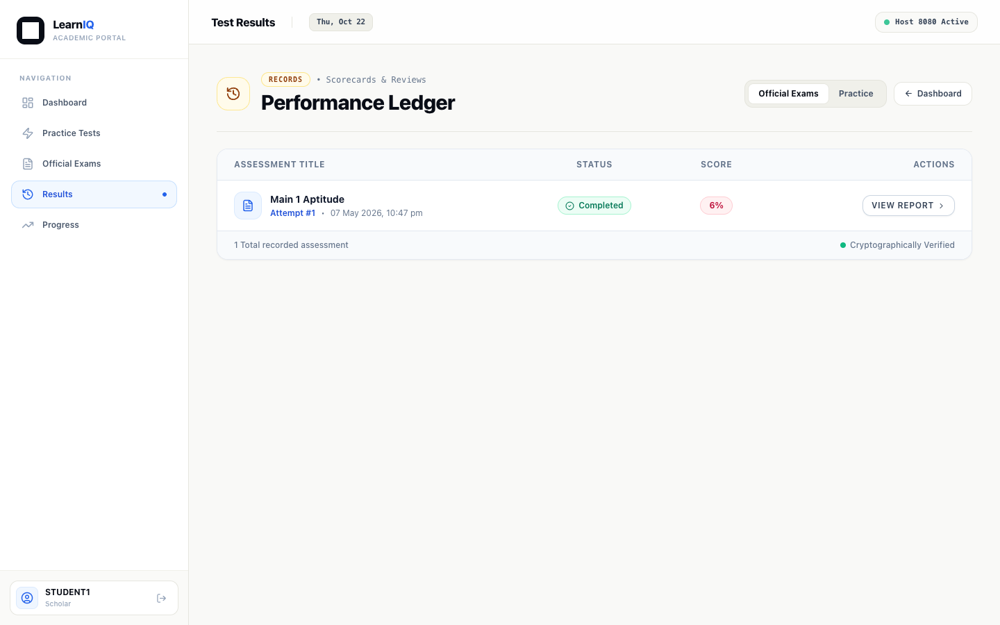
  <p><i>Instant post-test scorecard with percentage scores, accuracy metrics, and PDF scorecard export.</i></p>
  <br/>

  <h4>Detailed Question Review & Explanation Ledger</h4>
  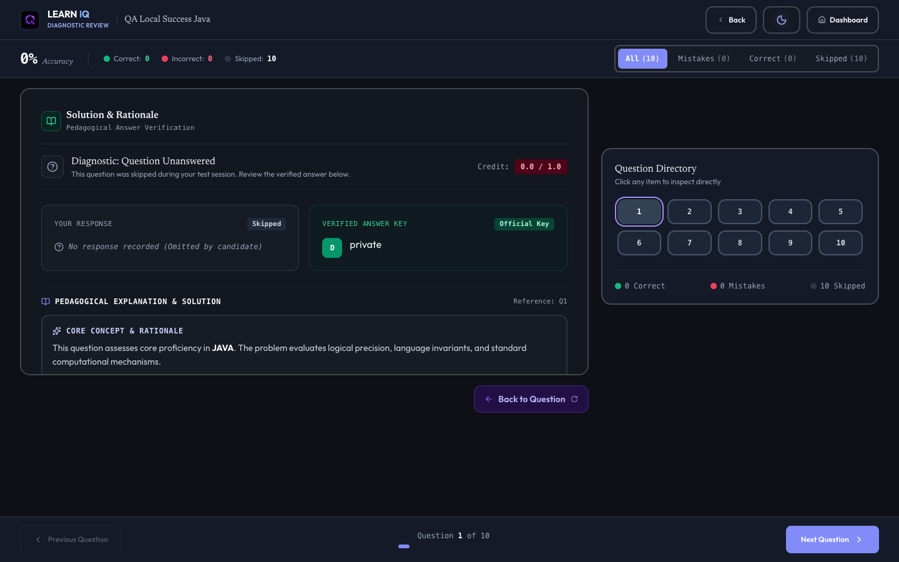
  <p><i>Comprehensive post-submission audit with correct answer rationales, student choices, and mistakes filter.</i></p>
  <br/>

  <h4>Longitudinal Progress & Category Analytics</h4>
  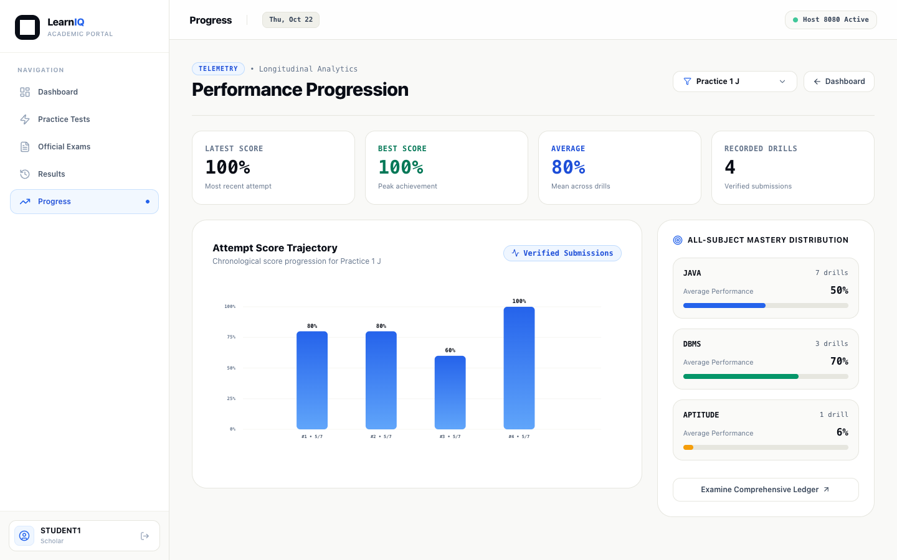
  <p><i>Historical performance tracking, completion trajectories, and discipline mastery distributions.</i></p>
</div>

---

### 3. Faculty & Administrative Command Center

<div align="center">
  <h4>Executive Telemetry Dashboard</h4>
  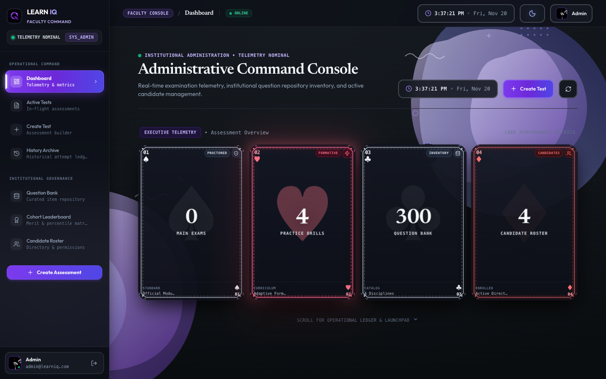
  <p><i>Institutional command deck showing active assessments, candidate metrics, and system telemetry.</i></p>
  <br/>

  <h4>Curated Question Bank Repository</h4>
  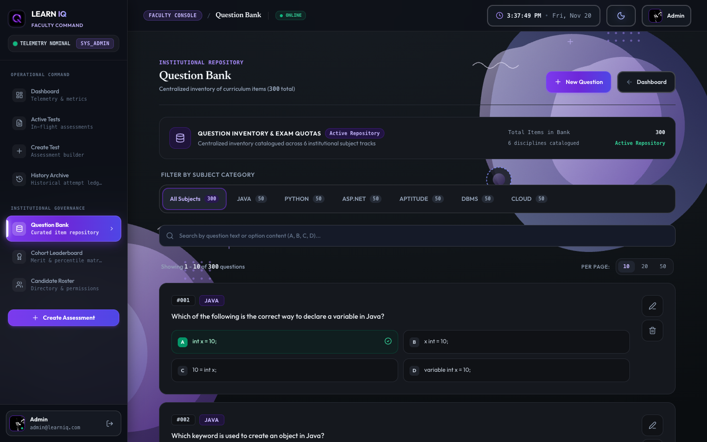
  <p><i>Centralized inventory of 300+ curricular items across 6 tracks with instant search, category filters, and pagination.</i></p>
  <br/>

  <h4>Multi-Step Assessment Builder Studio</h4>
  
  <p><i>4-stage authoring wizard: discipline selection, protocol mode, scheduling/duration quotas, and marking rules.</i></p>
  <br/>

  <h4>In-Flight Test Inventory & Cohort Monitors</h4>
  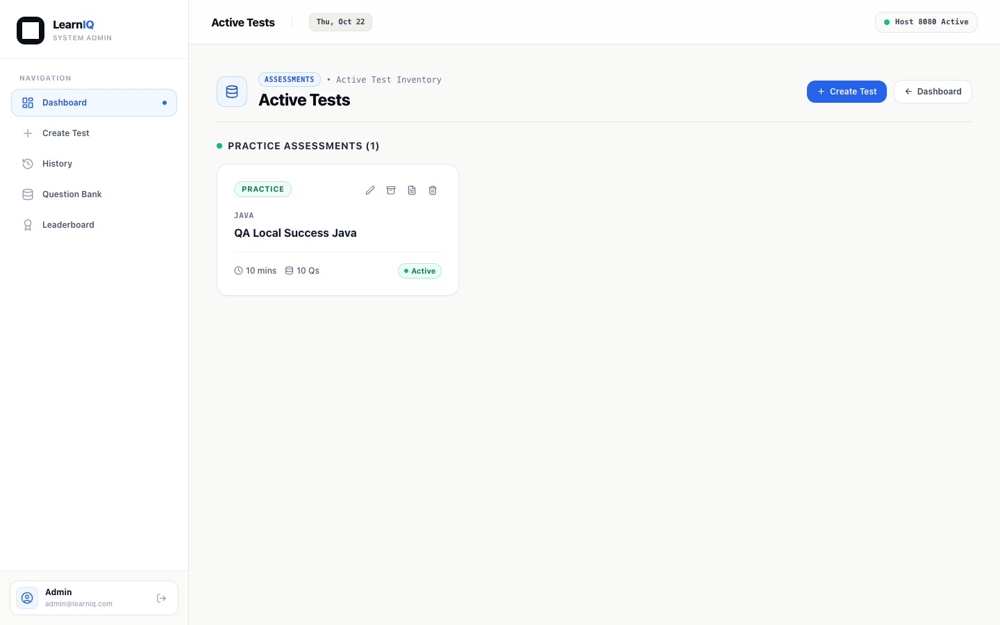
  <p><i>Fleet view of active, scheduled, and completed assessments with one-click administration actions.</i></p>
  <br/>

  <h4>Cohort Assessment Analytics</h4>
  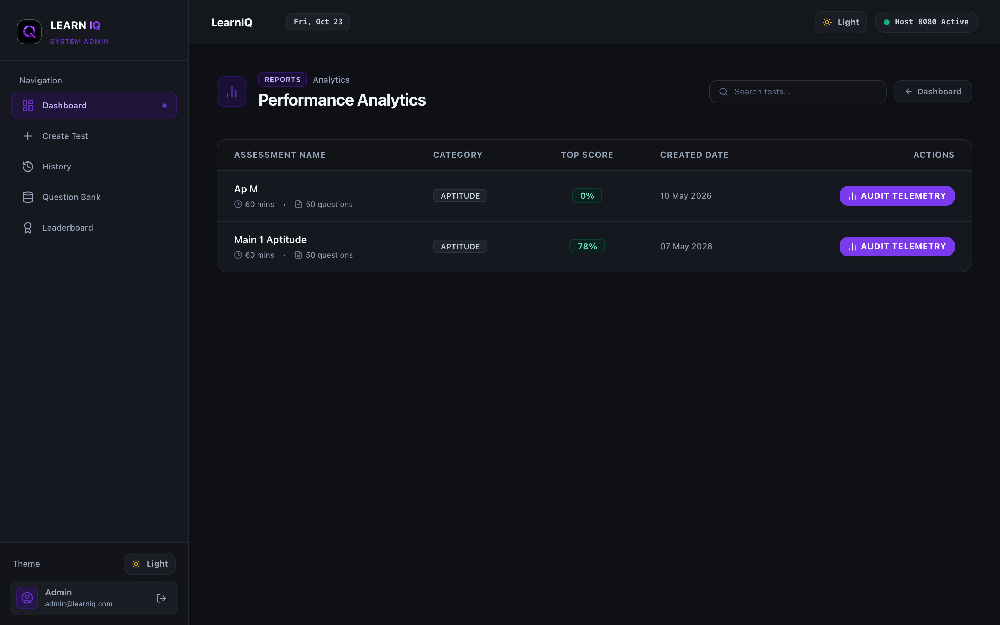
  <p><i>Deep statistical distributions: average scores, pass/fail ratios, completion times, and percentile ranks.</i></p>
  <br/>

  <h4>Merit Leaderboard & Podium Medal Rankings</h4>
  
  <p><i>Institutional leaderboards with gold/silver/bronze podium medals, percentile standings, and scores.</i></p>
  <br/>

  <h4>Candidate Directory & Identity Governance</h4>
  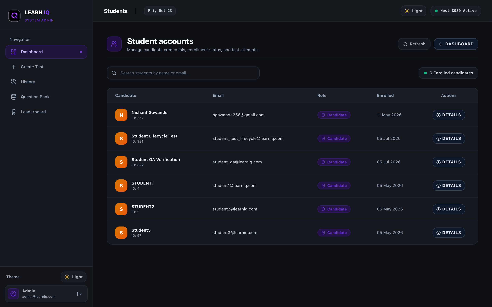
  <p><i>Student directory with verification statuses, attempt counts, institutional roles, and account controls.</i></p>
</div>

---

### 4. Responsive Mobile Experience

*Fully responsive layouts across all modules, verified on 390×844 mobile viewports with touch targets and collapsible drawer navigation.*

<div align="center">
  <table>
    <tr>
      <td align="center" width="33%">
        <b>Mobile Candidate Sign-In</b><br/><br/>
        
      </td>
      <td align="center" width="33%">
        <b>Mobile Student Cockpit</b><br/><br/>
        
      </td>
      <td align="center" width="33%">
        <b>Mobile Assessment Player</b><br/><br/>
        
      </td>
    </tr>
    <tr>
      <td align="center" width="33%">
        <b>Mobile Faculty Console</b><br/><br/>
        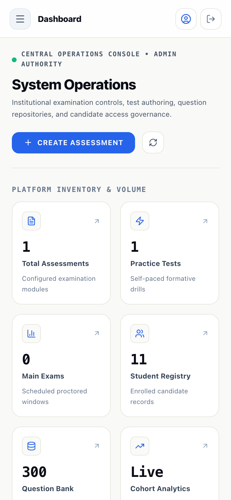
      </td>
      <td align="center" width="33%">
        <b>Mobile Question Repository</b><br/><br/>
        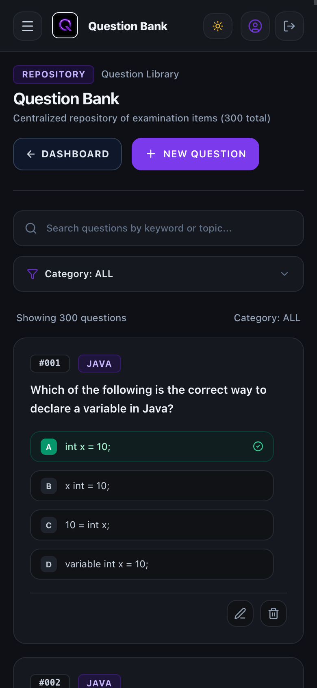
      </td>
      <td align="center" width="33%">
        <b>Mobile Assessment Builder</b><br/><br/>
        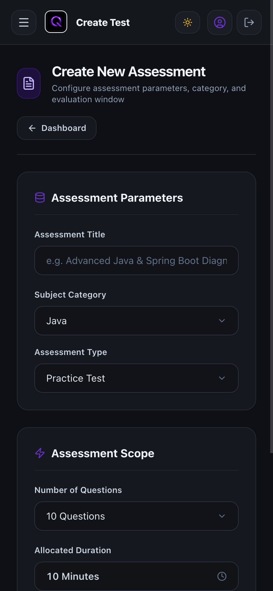
      </td>
    </tr>
  </table>
</div>

---

## ✨ Core Capabilities

### 🎓 Candidate (Student) Experience
* **Unified Workspace**: Single dashboard displaying upcoming scheduled tests, practice drills, and recent scorecard summaries.
* **Synchronized Testing Engine**: High-fidelity assessment environment with question navigation drawer, flagged questions, and multi-tier auto-save.
* **Instant Scorecard & PDF Export**: Instant post-test scoring with breakdown of total marks, percentage, correct/incorrect/skipped items, and one-click PDF generation.
* **Comprehensive Answer Review**: Step-by-step post-exam review with detailed question explanations, correct answers, and a "Show Mistakes Only" filter.
* **Longitudinal Progress Cockpit**: Historical performance trajectory, discipline-by-discipline accuracy charts, and completion stats.
* **Automated Email Notifications**: Asynchronous email dispatch with formatted test summaries delivered upon exam submission.

### 🛡️ Faculty (Administrator) Command Deck
* **Telemetry & Fleet Management**: Live overview of active candidates, total tests conducted, system question inventory, and real-time activity feeds.
* **Curated Question Repository**: Comprehensive repository supporting rich multiple-choice questions categorized across 6 curricular tracks (Java, Python, ASP.NET, Aptitude, DBMS, Cloud).
* **Multi-Step Assessment Authoring**: 4-step wizard for configuring title, discipline, protocol mode (`MAIN` scheduled vs `PRACTICE` on-demand), question quotas, duration, and scoring rules.
* **Deep Cohort Analytics**: Statistical analysis per assessment including score variance, pass/fail rates, time distributions, and student percentiles.
* **Cohort Leaderboards**: Live merit rankings with podium medals for top performers, scores, and completion timestamps.
* **Candidate Roster Governance**: Comprehensive user directory with verification status badges, total attempts taken, and account administration.

---

## 🧠 System Architecture & Tech Stack

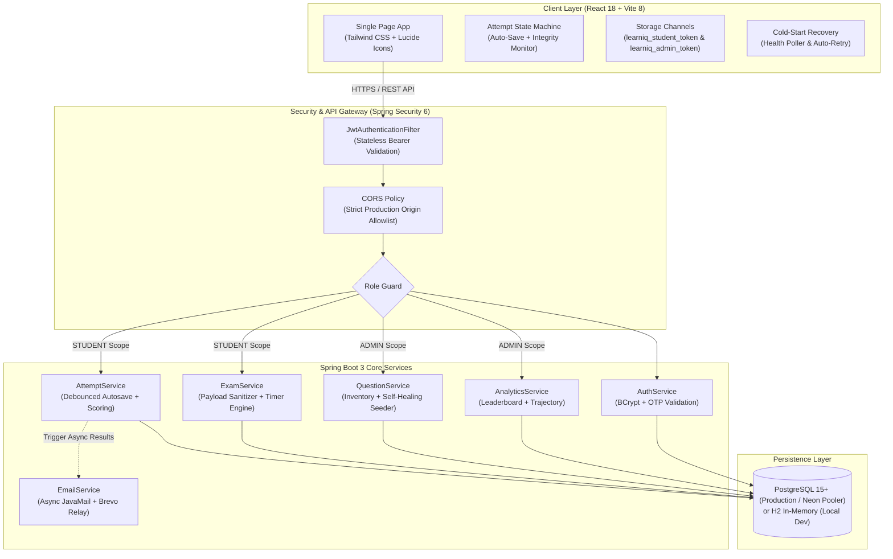

### Technology Breakdown

| Layer | Technologies | Rationale & Purpose |
|:---|:---|:---|
| **Frontend Framework** | React 18, Vite 8, React Router v6 | Sub-second cold compilation, code-split lazy routes, and declarative state rendering. |
| **Styling & UI Craft** | Tailwind CSS 3, Lucide React, Canvas Confetti | Apple-inspired dark mode surfaces (`#0E1015`), micro-animations, accessible contrast ratios. |
| **Document Export** | html2pdf.js, html2canvas | Client-side, high-fidelity PDF scorecard compilation with zero server rendering overhead. |
| **Backend Framework** | Java 17, Spring Boot 3.5+, Spring Data JPA | High-throughput enterprise service layer with strict compile-time type safety. |
| **Security & Auth** | Spring Security 6, JJWT (io.jsonwebtoken 0.12+) | Stateless HMAC-SHA signed JWTs, dual-token channel segregation, BCrypt password hashing. |
| **Database & ORM** | PostgreSQL (Neon serverless pooler) / H2 in-memory | Transactional consistency, soft-delete question modeling, and sub-millisecond query execution. |
| **Asynchronous Mail** | JavaMailSender, Brevo SMTP relay | Background thread pool execution for transactional registration OTPs and exam completion cards. |
| **Build & Deploy** | Maven 3.9, Docker multi-stage, Render.com | Reproducible artifact packaging and automated continuous delivery. |

---

## 📊 Data Models & Lifecycle Workflows

### 1. Entity-Relationship Schema

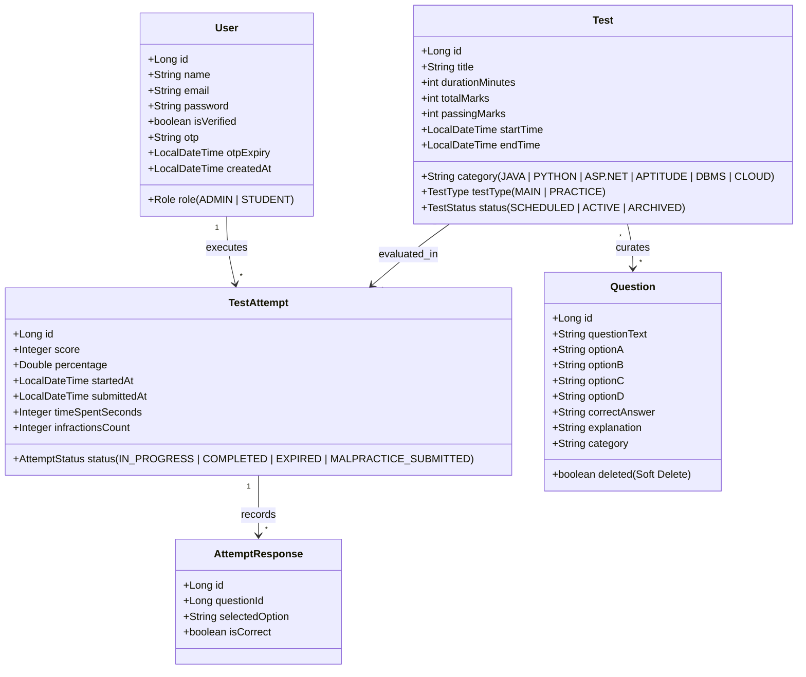

---

### 2. Assessment Lifecycle State Machine

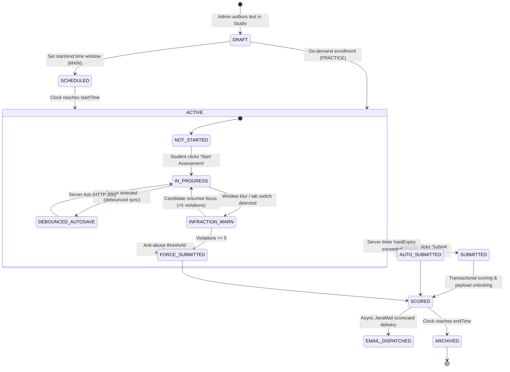

---

## 🛡️ Cold-Start Resilience & Session Integrity

### The Cloud Run / Render Spin-Down Challenge

Because Render's free tier suspends idle web services after 15 minutes of inactivity, first-time visitors commonly encounter 502/504 gateway timeouts or infinite loading states. LearnIQ resolves this with a dedicated architectural recovery system:

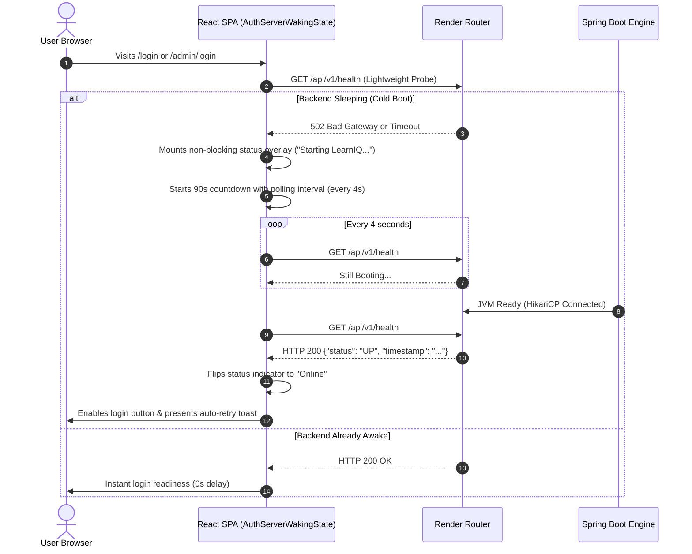

---

## 🔌 RESTful API Reference

All protected endpoints require an `Authorization: Bearer <token>` header. Candidate requests pass tokens through the student channel; faculty endpoints enforce `ROLE_ADMIN`.

### Authentication Endpoints (`/api/v1/auth`)

| Method | Endpoint | Access | Description |
|:---|:---|:---|:---|
| `GET` | `/api/v1/health` | Public | Lightweight health check used for cold-start wake polling. |
| `POST` | `/api/v1/auth/login` | Public | Authenticates candidate or faculty, returning signed JWT and role. |
| `POST` | `/api/v1/auth/register` | Public | Creates a candidate account with BCrypt password hashing. |
| `POST` | `/api/v1/auth/forgot-password` | Public | Generates and emails a 6-digit verification OTP. |
| `POST` | `/api/v1/auth/verify-otp` | Public | Validates OTP against stored hash and expiration. |
| `POST` | `/api/v1/auth/reset-password` | Public | Resets candidate password upon successful OTP verification. |

### Student Assessment Endpoints (`/api/v1/tests`)

| Method | Endpoint | Access | Description |
|:---|:---|:---|:---|
| `GET` | `/api/v1/tests/practice` | Student | Retrieves active on-demand practice tests. |
| `GET` | `/api/v1/tests/scheduled` | Student | Retrieves scheduled official assessments in current time window. |
| `POST` | `/api/v1/tests/{id}/start` | Student | Mounts a new test attempt, writes `startedAt`, returns masked questions. |
| `POST` | `/api/v1/tests/{id}/autosave` | Student | Debounced checkpoint saving selected options and remaining duration. |
| `POST` | `/api/v1/tests/{id}/submit` | Student | Authoritative evaluation, calculates final score, dispatches email. |
| `GET` | `/api/v1/tests/{id}/results` | Student | Fetches scorecard, total marks, percentage, and time spent. |
| `GET` | `/api/v1/tests/{id}/review` | Student | Unlocks full question breakdown with correct answers and explanations. |
| `GET` | `/api/v1/student/progress` | Student | Longitudinal history and category accuracy for current student. |

### Faculty Administration Endpoints (`/api/v1/admin`)

| Method | Endpoint | Access | Description |
|:---|:---|:---|:---|
| `GET` | `/api/v1/admin/dashboard` | Admin | Telemetry metrics: active tests, student count, total questions. |
| `GET` | `/api/v1/admin/questions` | Admin | Paginated question bank with category filters and keyword search. |
| `POST` | `/api/v1/admin/questions` | Admin | Adds a new question item to the institutional repository. |
| `PUT` | `/api/v1/admin/questions/{id}` | Admin | Modifies question text, options, category, or explanation. |
| `DELETE` | `/api/v1/admin/questions/{id}`| Admin | Soft-deletes a question item (`deleted = true`). |
| `POST` | `/api/v1/admin/tests` | Admin | Creates and schedules a new assessment from curricular pools. |
| `GET` | `/api/v1/admin/tests/active` | Admin | Lists active and scheduled test fleet. |
| `GET` | `/api/v1/admin/tests/{id}/analytics`| Admin | Statistical distributions, completion times, and score variance. |
| `GET` | `/api/v1/admin/tests/{id}/leaderboard`| Admin | Cohort merit leaderboard with podium rankings. |
| `GET` | `/api/v1/admin/students` | Admin | Candidate directory, verification status, and attempt tallies. |

---

## 💻 Local Environment Setup

### Prerequisites
* **Java**: JDK 17 or higher
* **Node.js**: v18.0.0 or higher (v20+ recommended)
* **Maven**: 3.9+ (or use bundled `./mvnw`)
* **Git**: Installed and configured

### 1. Clone the Repository
```bash
git clone https://github.com/Nishantsg3/LearnIQ.git
cd LearnIQ
```

### 2. Start the Backend Service
In development mode (`dev` profile, active by default), LearnIQ boots with zero external database configuration using local H2 in-memory storage and automatically seeds 300 curricular questions:

```bash
cd learniq-backend
APP_JWT_SECRET=learniq_production_grade_secure_session_jwt_secret_key_2026_x89a ./mvnw spring-boot:run
```
* Backend boots at: `http://localhost:8080`
* H2 Database Console: `http://localhost:8080/h2-console` (JDBC URL: `jdbc:h2:mem:learniq_dev`)

### 3. Start the Frontend Application
In a separate terminal, start the Vite development server:

```bash
cd learniq-frontend
npm install
npm run dev
```
* Frontend boots at: `http://localhost:5173`
* Vite automatically proxies API requests to `http://localhost:8080`

### 4. Seed Credentials (Local Development)
* **Student Login**: `student1@learniq.com` / `Student@123`
* **Admin Login**: `admin@learniq.com` / `Admin@123`

---

## 🌐 Production Deployment (Render)

LearnIQ is configured for dual-service deployment on Render.com:

### Frontend Web Service (Static Site)
* **Root Directory**: `learniq-frontend`
* **Build Command**: `npm install && npm run build`
* **Publish Directory**: `dist`
* **Environment Variables**:
  * `VITE_API_URL`: `https://learniq-backend-vglf.onrender.com/api/v1`

### Backend Web Service (Docker / Web Service)
* **Root Directory**: `learniq-backend`
* **Build Command**: `./mvnw clean package -DskipTests`
* **Start Command**: `java -jar target/*.jar`
* **Environment Variables**:
  * `SPRING_PROFILES_ACTIVE`: `prod`
  * `SPRING_DATASOURCE_URL`: PostgreSQL JDBC connection URL (e.g. Neon serverless endpoint)
  * `SPRING_DATASOURCE_USERNAME`: PostgreSQL database username
  * `SPRING_DATASOURCE_PASSWORD`: PostgreSQL database password
  * `APP_JWT_SECRET`: 64+ character cryptographic signing secret
  * `APP_FRONTEND_URL`: `https://learniq-frontend-7oyn.onrender.com` (for strict CORS policy)
  * `APP_SEED_ADMIN_EMAIL`: `admin@learniq.com`
  * `APP_SEED_ADMIN_PASSWORD`: Strong password for production admin account
  * `MAIL_USERNAME` / `MAIL_PASSWORD`: SMTP credentials for Brevo relay (optional)
  * `MAIL_FROM`: `learniq.main@gmail.com`

---

## 🧪 Test Metrics & Quality Gates

Every code change must satisfy strict engineering quality gates prior to deployment:

```
┌──────────────────────────────────────────────────────────────┐
│                  LEARNIQ QUALITY GATES                       │
├──────────────────────────┬─────────────────────────┬─────────┤
│ Verification Target      │ Metric / Evidence       │ Status  │
├──────────────────────────┼─────────────────────────┼─────────┤
│ Backend Unit Tests       │ 201 tests, 0 failures   │ PASSING │
│ Backend Test Suites      │ 18 comprehensive suites │ PASSING │
│ Frontend ESLint Hygiene  │ 0 errors, 0 warnings    │ PASSING │
│ Frontend Production Pack │ Cold Vite build in 719ms│ PASSING │
│ Responsive Viewports     │ 1440×900 & 390×844      │ AUDITED │
│ Cold-Start Recovery UX   │ Polling + Auto-Retry    │ PASSING │
│ Question Bank Seeding    │ 300 items across 6 tracks│ PASSING │
└──────────────────────────┴─────────────────────────┴─────────┘
```

Run test suites locally:
```bash
# Backend Test Suite
cd learniq-backend && ./mvnw test

# Frontend Linter & Build Suite
cd learniq-frontend && npm run lint && npm run build
```

---

## 📄 License & Intellectual Property

This project is licensed under the MIT License. See [LICENSE](LICENSE) for details.

Developed with precision by **Nishant Gawande** ([@Nishantsg3](https://github.com/Nishantsg3)).

---

<div align="center">
  
  <p><b>LearnIQ</b> — Precision Assessment & Learning Intelligence Platform © 2026</p>
</div>